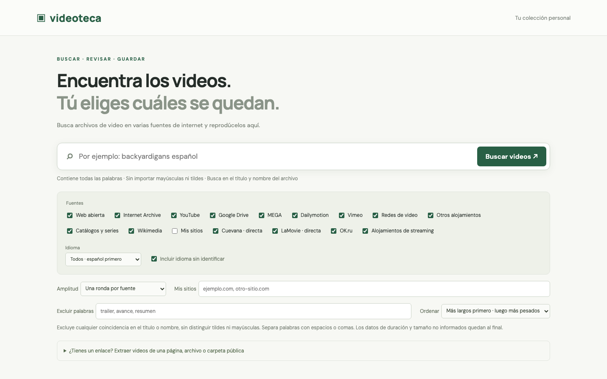
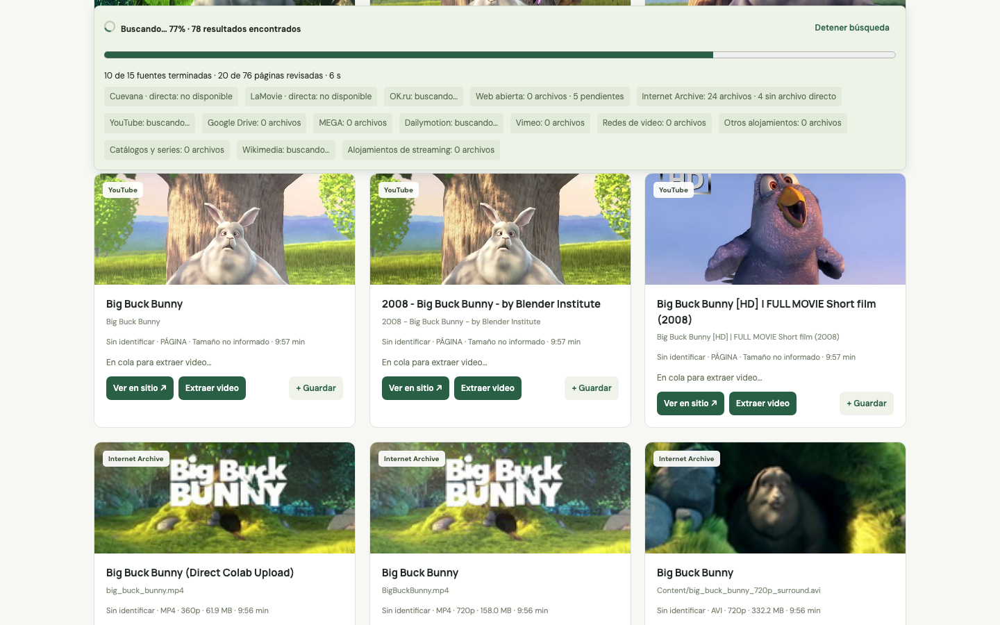

# Videoteca

Web local en español para buscar archivos de video, reproducirlos, descargarlos y guardar una selección personal, sin filtros de contenido propios.

## Galería

<table>
<tr>
<td align="center" valign="top"><br><sub>Búsqueda y fuentes disponibles</sub></td>
<td align="center" valign="top"><br><sub>Resultados para Big Buck Bunny</sub></td>
</tr>
<tr>
<td align="center" valign="top"><br><sub>Consulta con resultados</sub></td>
</tr>
</table>

Abre **http://localhost:4317**. Para volver a iniciarla, haz doble clic en **Abrir Videoteca.command**. Puedes cerrar Terminal: el servidor sigue funcionando en segundo plano. Si no inicia, revisa el registro de inicio local.

## Instalación

Requiere Node 22+, Python 3 y FFmpeg (para el modo de reproducción compatible).

```sh
cd videoteca
npm ci
python3 -m venv .venv
.venv/bin/pip install 'yt-dlp[default]'
npm start
```

En Windows, copia la carpeta y abre **Abrir Videoteca Windows.cmd**. Requiere Node 22+, Python 3 y FFmpeg en PATH. El iniciador comprueba los requisitos, instala dependencias faltantes y crea `.venv-win`, separado del entorno de macOS. La primera ejecución necesita internet. Mantén abierta su consola. El script fue revisado en macOS; no se ha ejecutado en Windows en esta sesión.

## Búsqueda y fuentes

- Internet Archive, Wikimedia, YouTube y Dailymotion tienen consultas propias.
- La búsqueda web consulta Brave Search y usa Bing RSS como alternativa. Se amplía con consultas específicas para Google Drive, MEGA, Vimeo, OK.ru, VK, Facebook, TikTok, MediaFire, Dropbox, OneDrive, Pixeldrain, GoFile, Streamtape y catálogos de series (incluida la palabra Cuevana). Los grupos son estrategias de descubrimiento, no índices completos ni garantía de extracción de todos los sitios nombrados.
- **Catálogos y series** incluye consultas para lamovie.org, cuevana8.plus y búsquedas por nombre de Cuevana, Repelis, Cinecalidad, La Movie y Pelisplus, que pueden descubrir otros dominios. Esto no certifica todas sus versiones ni su disponibilidad.
- **Alojamientos de streaming** añade consultas para Streamwish/StreamHG, FileMoon, Vidhide, VOE, Doodstream, Streamtape, Netu, Mixdrop, Sendvid y MP4Upload. **OK.ru** tiene su propia fuente. Se reconocen enlaces de estos alojamientos dentro de HTML y JSON, además de enlaces a episodios del mismo sitio; la extracción sigue limitada a 12 páginas y depende del soporte del sitio.
- **Google Drive** usa consultas con operadores `site:drive.google.com/file/d/`, `site:drive.google.com/drive/folders/`, `site:docs.google.com/file/` y menciones de enlaces públicos. Son consultas tipo dork enviadas a Brave/Bing; no una conexión al buscador Google ni acceso a archivos privados.
- **Mis sitios** permite añadir hasta 30 dominios, sin cambiar el código.
- Puedes consultar una, tres o cinco rondas por fuente. **Buscar más archivos** avanza una ronda adicional. Los motores pueden repetir resultados o ignorar parte de una consulta; se eliminan páginas ya revisadas y no se atribuyen resultados de dominios ajenos a Drive/MEGA.
- **Extraer enlace** admite páginas, reproductores, archivos directos y carpetas públicas. Los enlaces MEGA deben incluir la clave pública después de `#`. Las carpetas MEGA se enumeran; las carpetas de Drive se inspeccionan siguiendo su listado público.
- La extracción inspecciona HTML, configuración JSON, reproductores incrustados y enlaces de nube. El extractor genérico de yt-dlp amplía el soporte a otros sitios. Por solicitud se revisan como máximo 12 páginas relacionadas, hasta dos niveles de enlaces; las carpetas MEGA devuelven hasta 1500 videos. No se ejecutan scripts de páginas externas.

Todas las palabras deben aparecer como subcadenas en la combinación de título y nombre del archivo, sin distinguir tildes ni mayúsculas. No es búsqueda dentro del audio. Al importar un enlace manualmente se muestran los videos de ese enlace sin aplicar la consulta anterior.

**Excluir palabras** oculta cualquier resultado cuyo título o nombre de archivo contenga alguna de las palabras indicadas (separadas por espacios, comas o punto y coma), sin distinguir mayúsculas ni tildes. Funciona al instante sobre resultados, importaciones y biblioteca; al borrar una exclusión se recuperan los resultados. El contador muestra visibles / encontrados. La exportación respeta los filtros.

**Ordenar** muestra por defecto los más largos primero, desempatando por tamaño. También permite los más pesados primero, desempatando por duración, o el orden de llegada. Las tarjetas muestran duración y peso cuando la fuente los publica; los tamaños estimados se marcan como aproximados. Los datos desconocidos quedan al final según el criterio elegido. El filtro y el orden se recuerdan en el navegador. El orden se aplica a los archivos encontrados, no a todo el catálogo de internet.

Las fuentes **Cuevana**, **LaMovie** y **OK.ru** consultan sus buscadores públicos directamente, sin depender de Brave/Bing. OK.ru consulta también la variante «latino» si no se indicó un idioma en el texto. Estas búsquedas directas usan la primera página/lista pública disponible; no simulan rondas adicionales si el sitio no ofrece paginación verificada. LaMovie consulta además su listado público de reproductores. OK.ru admite metadatos del reproductor tanto en formato objeto como texto.

Los títulos encontrados aparecen enseguida. Mientras se extrae el video, la tarjeta indica su estado y permite **Ver en sitio**. Si se obtiene un archivo, aparecen reproducción y descarga; si falla, la página encontrada sigue visible sin presentarse como un archivo reproducible. Una página puede no producir archivos si exige sesión, usa DRM, bloquea la extracción o necesita JavaScript que el extractor no entiende. La búsqueda pública no descubre archivos privados, enlaces no indexados o claves MEGA ausentes. Los proveedores conservan sus propias restricciones.

La barra de progreso permanece visible al desplazarte: muestra avance de las fuentes/rondas, páginas revisadas y tiempo transcurrido. No estima tiempo restante. Solo llega al 100% cuando terminaron todos los trabajos, incluidos los que fallaron, con el mensaje **Búsqueda terminada** y avisos de errores. Detener conserva los resultados y muestra **Búsqueda detenida** sin marcar 100%. Cada petición tiene un límite de 60 segundos y cada fuente un presupuesto de 150 segundos por búsqueda; las páginas pendientes siguen disponibles para abrir o reintentar su extracción.

Brave puede limitar las consultas HTTP. La app espacia solicitudes, suspende temporalmente ese motor tras HTTP 429 y comunica el uso del buscador alternativo. Para uso frecuente se puede configurar `BRAVE_SEARCH_API_KEY` en el entorno; la clave se utiliza solo en el servidor. No se resuelven captchas ni se sortean bloqueos. Bing RSS puede ofrecer cobertura muy limitada y repetir resultados.

## Reproducción

Las variantes de calidad de un mismo video y fuente se agrupan en una tarjeta por idioma. Se selecciona primero la mayor resolución disponible, después FPS y tamaño; el selector permite bajar la calidad. No se fusionan películas de distintas fuentes solo porque compartan título. HLS también tiene selector de sus niveles de calidad. El reproductor comienza a velocidad **1×** y ofrece velocidad variable, saltos de 10 segundos, barra de posición, pantalla completa y ventana flotante cuando el navegador lo permite.

Los archivos se sirven en streaming a través del servidor local con disposición inline. HLS usa HLS.js. El **Modo compatible** convierte el video a H.264/AAC y transmite MP4 fragmentado mediante FFmpeg, sin guardar una película completa. Se activa automáticamente para MKV/AVI/MPEG/MOV o ante errores del modo normal, y también puede elegirse manualmente. Consume CPU, permite hasta dos conversiones simultáneas y se detiene al cerrar el reproductor. Para saltar en este modo usa la barra de posición o los botones de 10 segundos: reinician la conversión desde ese punto. Los enlaces MEGA se descifran usando su clave pública y se sirven por rangos. No garantiza reproducción de fuentes caídas, protegidas, restringidas o archivos dañados.

**Ver en otra pestaña** abre el reproductor local con el mismo video, sin navegar al archivo remoto ni provocar una descarga. Los botones de descarga se han retirado de la interfaz. Los avisos de las búsquedas quedan en **Detalles de las fuentes**, cerrado por defecto.

La página presenta inicialmente 120 videos agrupados; **Ver todo** muestra todos los resultados encontrados y los que sigan llegando. **Buscar más archivos** realiza nuevas consultas. Se limitan las tareas simultáneas y se pausan nuevas extracciones mientras el reproductor está abierto. Detener la búsqueda cancela las solicitudes activas y los procesos de extracción asociados.

Los idiomas provienen de metadatos o etiquetas explícitas del título (latino, castellano, español), no de análisis del audio. Se priorizan español y sus variantes, después los no identificados y finalmente los demás idiomas; dentro de cada grupo se aplica el orden de duración o tamaño. El filtro Español incluye todas sus variantes; Latino y Castellano permiten separarlas. La biblioteca se guarda en localStorage; exportar JSON guarda los enlaces, no una copia de los videos.

## Configuración y acceso

- `PORT`: 4317 por defecto.
- `YTDLP_PATH`: ejecutable alternativo de yt-dlp.
- `FFMPEG_PATH`: ejecutable alternativo para el modo compatible.
- `BRAVE_SEARCH_API_KEY`: clave opcional del buscador.

El servidor escucha solo en loopback y valida Host/Origin. Las peticiones propias bloquean redes privadas, fijan la IP de conexión y revalidan redirecciones; usan IPv4. yt-dlp pasa por un proxy local autenticado que también verifica sus destinos. No publiques este servidor directamente en internet. Los archivos se transmiten en streaming, sin cargarlos completos en memoria.

## Validación

```sh
npm test
node tests/browser.mjs
node tests/providers.mjs
node tests/filter-browser.mjs
node tests/filter-browser.mjs --live
```

Las pruebas unitarias cubren coincidencia de palabras, rangos, selección de versión, extracción de enlaces, carpetas Drive, manifiestos HLS, cancelación y bloqueo de destinos privados. Las de navegador usan Chrome instalado en macOS y fuentes reales; comprueban persistencia, móvil, estabilidad de tarjetas, velocidad de reproducción, HLS y descarga MP4. Las pruebas de proveedores requieren internet y pueden verse limitadas por las fuentes externas. No se ha certificado cada plataforma ni cada variante de archivo de MEGA con un enlace real.

Referencias: [yt-dlp](https://github.com/yt-dlp/yt-dlp) · [HLS.js](https://github.com/video-dev/hls.js) · [MEGAJS](https://mega.js.org/docs/1.0/api) · [Dailymotion](https://developers.dailymotion.com/me/v0/reference/api-list-videos) · [Wikimedia](https://www.mediawiki.org/wiki/Extension:TimedMediaHandler/API).
